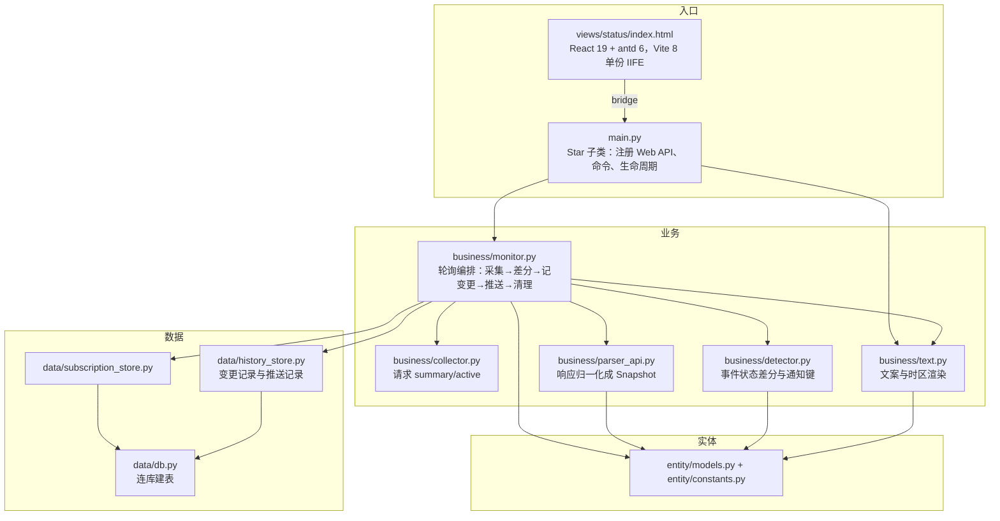

# DeepSeek 服务整体状态监控与订阅

Feature Name: deepseek-status-monitor
Updated: 2026-10-20

## Description

本设计实现 `specs/deepseek-status-monitor/requirements.md` 中的 11 条需求：每轮只请求状态页的 `summary/active`，把 `active_changes` 里每条事件的 `status` 与上一轮比较，把新出现与状态变化合并成一条通知推给订阅会话，并为每条变化写一行变更记录；整体状态（没有未结束事件即正常）仍用于命令与页面。提供 `dsstatus` 命令、订阅管理页面与变更记录页面。状态页的组件消失/出现、组件级状态、事件时间线、Atom/RSS 都不在范围内。

不在范围内：向 DeepSeek 提交任何数据、调用状态页的邮箱订阅接口、解析 HTML、90 天可用性展示、对 `api.deepseek.com` 做真实拨测。

## 数据源事实（2026-10-15 实测，2026-10-20 复核）

结论：页面首屏「一切运行正常 / 所有系统均按预期运行」由 `summary/active` 计算：把 `active_changes` 里 `resolved` / `completed` 的条目过滤掉，剩下为空即正常。页面没有单独的“整体状态”字段。

| 接口 | 是否使用 | 说明 |
|---|---|---|
| `GET /api/status-page/6410630422455/summary/active` | **唯一使用** | `data.page`（页面配置）与 `data.active_changes[]`（事件列表，含已结束条目） |
| `GET /api/status-page/6410630422455/change/list` | 不用 | 服务端历史列表；本插件自己记变更，不需要 |
| `GET /api/status-page/6410630422455/change/info` | 不用 | 事件详情；本轮不展示时间线 |
| `GET /api/status-page/6410630422455/summary/structure` | 不用 | 90 天可用性 |
| `GET /feed.atom` / `GET /feed.rss` | 不用 | 只有事件条目，没有“健康”条目，不能证明正常 |
| `GET /api/v2/summary.json` | 不存在 | 404 |

约定与坑：

- 成功体为 `{"request_id": "...", "data": {...}}`；失败体为 `{"request_id": "...", "error": {"code", "message"}}`，HTTP 400 也是这个形状。
- `data.page.components[]` 没有 `status` 字段；组件状态只能从 `active_changes[].affected_components[].status` 推导。本设计不读组件，避免组件消失/出现带来的复杂度。
- `active_changes[]` 应包含 `change_id`、`type`、`title`、`status`、`affected_components[]` 等字段；事件详情链接由 `change_id` 拼出。
- 事件状态：`investigating`、`identified`、`monitoring`、`resolved`、`scheduled`、`ongoing`、`completed`；只有 `resolved` 与 `completed` 算已结束。
- `summary/active` 响应头带 `s-maxage=10, stale-while-revalidate=30`；页面前端 60 秒刷新一次。轮询默认 60 秒、下限 30 秒。
- 2026-10-15 与 2026-10-20 两次实测 `active_changes` 都是空数组，**进行中事件的真实响应还没抓到**；解析按接口文档字段实现，抓到后补 fixture。

## Architecture

依赖单向：`main.py` → `business/` → `data/`；`entity/` 不依赖 AstrBot，也不访问数据库。

一次轮询的顺序：

1. `GET /summary/active`，成功则解析出 `Snapshot`（包含全部事件，含已结束的）。
2. 逐条比较事件：新出现或 `status` 取值变化记一条变化；上一轮有、本轮消失不算；首次采集只建基线。
3. 有变化时先为每条变化写一行变更记录，再把本轮所有变化合并成一条通知；变更记录写入失败则本轮不推送、不替换快照。
4. 推送 → 逐会话写推送结果。
5. 按保留天数清理变更记录与推送记录。

关键约定：

- 插件数据目录用 `StarTools.get_data_dir(PLUGIN_NAME)` **显式传插件名**；从 `data/db.py` 子模块调用不传名会抛 `RuntimeError`（参考 [^3]）。
- 页面目录用官方首选名 `views/`，只做 **一个视图** `views/status/`，页内 antd `Tabs` 切换「概览与配置 / 订阅管理 / 变更记录」，不改顶层 hash。
- 轮询用 `asyncio` 后台任务，在 `initialize()` 启动、`terminate()` 取消（参考 [^7]、[^8]），不引入 `apscheduler`。
- 页面 ID `6410630422455` 写成常量；状态页重建时改这一处。

## Components and Interfaces

### 实体层 `entity/`

`entity/constants.py`

| 名字 | 含义 |
|---|---|
| `PLUGIN_NAME` | `"astrbot_plugin_deepseek_status"` |
| `STATUS_PAGE_BASE` | `"https://status.deepseek.com"` |
| `PAGE_ID` | `"6410630422455"` |
| `REQUEST_TIMEOUT_SECONDS` | `10` |
| `CLOSED_EVENT_STATUSES` | `{"resolved", "completed"}` |
| `NOTIFY_CHANGES` | `"changes"`：一轮事件状态变化的汇总通知 |
| `STATUS_LABELS` | 事件状态中文映射：`investigating` 调查中、`identified` 已定位、`monitoring` 观察中、`scheduled` 已排期、`ongoing` 进行中、`resolved` 已解决、`completed` 已完成 |
| `EVENT_TYPE_LABELS` | 事件类型中文映射：`incident` 故障、`maintenance` 计划维护；表里没有的类型原样输出 |
| `COMMAND_NAME` | `"dsstatus"`：默认指令名，实际生效名由 AstrBot 指令管理决定 |
| `DEFAULT_TIMEZONE` | `ZoneInfo("Asia/Shanghai")`：配置为空或非法时的回退时区 |

`entity/models.py`：

- `StatusEvent`：`change_id: int`、`change_type: str`、`title: str`、`status: str`、`link: str`。
- `Snapshot`：`status: str`（`normal` / `abnormal`，按过滤已结束事件后计算）、`events: list[StatusEvent]`（保留全部事件，含已结束的）、`fetched_at: str`（UTC ISO8601 带 `Z`）。
- `Subscription`：`id: int`、`session: str`、`note: str`、`enabled: bool`、`created_at: str`、`updated_at: str`。
- `Notification`：`notify_type: str`、`dedup_key: str`、`message: str`。
- `MonitorConfig`：`enabled: bool`、`poll_interval_seconds: int`、`notify_enabled: bool`、`history_retention_days: int`、`display_timezone: str`；由入口层从原始配置转换后注入 `Monitor`。

### 数据层 `data/`

`data/db.py`

- `def get_db_path() -> Path`：`StarTools.get_data_dir(PLUGIN_NAME) / "deepseek_status.db"`；只在插件运行时调用。
- `def connect(db_path: Path) -> sqlite3.Connection`：打开连接、设 `row_factory`、开 WAL；路径由调用方传入，测试用临时目录。
- `def init_db(conn: sqlite3.Connection) -> None`：建三张表（`CREATE TABLE IF NOT EXISTS`）。
- `def utc_now() -> str`：当前 UTC 时间，ISO8601 带 `Z`。

`data/subscription_store.py`

- `def list_subscriptions(conn, only_enabled: bool = False) -> list[Subscription]`
- `def get_by_session(conn, session: str) -> Subscription | None`
- `def get_by_id(conn, sub_id: int) -> Subscription | None`
- `def enable_session(conn, session: str, note: str) -> tuple[Subscription, bool]`：命令「开」；新建时置为启用，已存在时若停用则重新启用并保留备注，返回 `(记录, 是否新建)`。
- `def disable_session(conn, session: str) -> bool`：命令「关」置为停用。
- `def create(conn, session: str, note: str, enabled: bool) -> tuple[bool, str]`：页面新增，会话标识重复时返回失败原因。
- `def update(conn, sub_id: int, note: str, enabled: bool) -> bool`：页面编辑。
- `def delete(conn, sub_id: int) -> bool`：页面删除。

`data/history_store.py`

- `def record_change(conn, event: StatusEvent, fetched_at: str) -> int`：为一条变化写一行变更记录，返回主键。
- `def list_changes(conn, page: int, size: int) -> tuple[list[dict], int]`：变更记录分页，按采集时间倒序。
- `def record_push(conn, session: str, dedup_key: str, notify_type: str, message: str, ok: bool, error: str) -> None`：写一条推送结果（成功/失败、失败原因与原始报错）和消息正文，每次推送只写一条。
- `def purge_expired(conn, retention_days: int) -> int`：删除采集时间/推送时间超过保留天数的变更记录与推送记录，返回条数。

### 业务层 `business/`

`business/collector.py`

- `class CollectorError(Exception)`：请求层失败（超时、非 200、非法 JSON）。
- `def api_url(path: str) -> str`：拼 `STATUS_PAGE_BASE + /api/status-page/{PAGE_ID} + path`。
- `def make_timeout()`：10 秒 `aiohttp.ClientTimeout`；`aiohttp` 在函数内延迟导入。
- `async def fetch_summary_active() -> dict`：GET 并返回响应体的 `data` 字段；非 200 或 JSON 解码失败抛 `CollectorError`，缺少 `data` 抛 `ValueError`。

`business/parser_api.py`

- `def parse_event(item: dict) -> StatusEvent`：解析一条状态事件（含已结束的）；`change_id` 必须是整数、`status` 必须是非空字符串，否则抛 `ValueError` 并带字段名。
- `def parse_snapshot(data: dict, fetched_at: str) -> Snapshot`：`data.active_changes` 必须是数组，元素必须是对象；保留全部事件，整体状态按过滤 `resolved` / `completed` 后计算，空为 `normal`、否则 `abnormal`。
- `def event_link(change_id: int) -> str`：`https://status.deepseek.com/incidents/{change_id}`。

`business/detector.py`

- `def detect_event_changes(previous: Snapshot | None, current: Snapshot) -> list[StatusEvent]`：`previous` 为空返回空列表；按 `change_id` 比对，新出现或 `status` 不同的事件按当前快照顺序返回；上一轮有、本轮消失的忽略。
- `def changes_key(snapshot: Snapshot) -> str`：`f"changes:{snapshot.fetched_at}"`，一轮通知一个键。

`business/text.py`

- `def resolve_timezone(raw: str) -> ZoneInfo`：空或非法回退 `DEFAULT_TIMEZONE` 并记 warning。
- `def to_local(fetched_at: str, tz: ZoneInfo) -> str`：UTC ISO 字符串按传入时区渲染。
- `def render_changes(changes: list[StatusEvent], fetched_at: str, tz: ZoneInfo) -> str`：本轮变化汇总；每条列出标题、类型、新状态与链接，状态与类型查中文映射，查不到原样输出。
- `def render_summary(snapshot: Snapshot, tz: ZoneInfo) -> str`：当前状态摘要（订阅建立或启用时推送）。
- `def render_status_reply(snapshot: Snapshot | None, tz: ZoneInfo) -> str`：命令回复；快照为空时回复暂无数据。
- `def render_help(command_name: str) -> str`：命令用法，使用实际触发的指令名。

`business/monitor.py`

- `class Monitor`：持有 `conn`、`config`、`context`、内存快照。
- `async def start(self) -> None` / `async def stop(self) -> None`：起停后台任务。
- `async def run(self) -> None`：循环调用 `_tick`，单轮异常只记日志。
- `async def _tick(self) -> None`：采集 → 事件差分 → 写变更记录 → 推送 → 清理。
- `async def _collect(self) -> Snapshot | None`：调采集与解析；`CollectorError` / `ValueError` 分别记「请求失败」/「接口结构异常」，返回 `None`。
- `async def _dispatch(self, notification: Notification) -> None`：给每个启用订阅推送这一条通知，相邻两条间隔 1 秒；单条失败记日志后继续，不重试。
- `async def push_summary(self, session: str) -> bool`：订阅建立或启用后主动查一次，推“DeepSeek 状态监控已开启…”前缀 + 当前状态；产品只支持群聊，固定说“本群”。
- `def snapshot(self) -> Snapshot | None`：供命令与页面读取。

### 入口层 `main.py`

- `class Plugin(Star)`：`__init__` 打开数据库、注册全部路由、注册命令、创建 `Monitor`；`initialize()` 启动；`terminate()` 停止并关连接。
- 平台发现：`_onebot_platform` 用 `bot.call_action` 识别 OneBot 实例，不按平台名写死；`_normalize_session` 把 UMO 前缀改成 `meta().id`，启动时迁移旧订阅，兼容 `aiocqhttp` 前缀与 `napcat` 等自定义实例 id。
- `async def dsstatus(self, event, sub: str = "")`：会话内命令；只处理群聊，私聊直接忽略；`sub` 取「开 / 关 / 帮助」。帮助与未知子命令的文案用 `event.message_str` 首个 token 作为实际指令名。
- Web API 路由：

| 方法 | 路由 | 处理函数 | 说明 |
|---|---|---|---|
| GET | `/{PLUGIN}/settings` | `page_get_settings` | 读非密钥配置 |
| POST | `/{PLUGIN}/settings/save` | `page_save_settings` | 写回配置并 `save_config()` |
| GET | `/{PLUGIN}/status` | `page_get_status` | 当前快照 |
| GET | `/{PLUGIN}/subscriptions` | `page_list_subscriptions` | 订阅列表 |
| POST | `/{PLUGIN}/subscriptions` | `page_create_subscription` | 新增订阅 |
| POST | `/{PLUGIN}/subscriptions/<sub_id>/update` | `page_update_subscription` | 编辑订阅 |
| POST | `/{PLUGIN}/subscriptions/<sub_id>/delete` | `page_delete_subscription` | 删除订阅 |
| GET | `/{PLUGIN}/history` | `page_list_changes` | 变更记录分页 |
| GET | `/{PLUGIN}/group-name` | `page_get_group_name` | 按群号取群名 |

> 页面 bridge 只提供 `apiGet` / `apiPost`，所以写操作统一用 POST；不能注册 PUT / DELETE 后指望自定义页面调用。

### 前端 `dashboard/` 与 `views/status/`

技术栈按 ai-kit 默认技术栈：**React 19 + antd 6 + TypeScript 6 + Vite 8**，构建用 Node 24；不引 Tailwind。

| 文件 | 作用 |
|---|---|
| `dashboard/index.html` | 挂载点 `#root`；内联脚本按宿主 query 的 `theme` / `isDark` 铺底色 |
| `dashboard/package.json` | `antd ^6.6.5`、`react ^19.3.0`、`@ant-design/cssinjs ^2.1.2`；`build` 为 `tsc --noEmit && vite build` |
| `dashboard/vite.config.ts` | `base: "./"`、`outDir: "../views/status"`、`cssCodeSplit: false`、`format: "iife"`、`entryFileNames: "assets/index.js"` 与去 `type="module"` 的插件 |
| `dashboard/src/main.tsx` | `StyleProvider layer` 包住应用 |
| `dashboard/src/App.tsx` | `ConfigProvider` + antd `Tabs` 承载三个视图，`onChange` 只改 React state |
| `dashboard/src/bridge.ts` | 封装 `window.AstrBotPluginView || window.AstrBotPluginPage` |
| `dashboard/src/{status,subscriptions,changes}-view.tsx` | 概览与配置、订阅管理、变更记录 |
| `dashboard/src/style.css` | 无 `@layer` 的自定义样式 |

构建命令 `cd dashboard && npm run build`，产物提交进仓库。

## Data Models

### `_conf_schema.json`（非密钥，全部出现在配置页）

| 字段 | 类型 | 默认 | 约束 |
|---|---|---|---|
| `enabled` | bool | `false` | 监控总开关 |
| `poll_interval_seconds` | int | `60` | 30 至 3600 |
| `notify_enabled` | bool | `true` | 通知推送开关 |
| `history_retention_days` | int | `30` | 1 至 365 |
| `display_timezone` | string | `"Asia/Shanghai"` | IANA 时区名，如 `Asia/Shanghai`、`America/New_York`、`UTC`；不接受 `UTC+8` |

### 内存结构

- `Snapshot`：`status`（`normal` / `abnormal`，按过滤已结束事件后计算）、`events`（全部事件，含已结束的）、`fetched_at`（UTC ISO8601 带 `Z`）。
- 启动后首次采集只建基线，不写变更记录、不发通知。

### SQLite（`data/plugin_data/astrbot_plugin_deepseek_status/deepseek_status.db`）

`subscriptions`

| 列 | 类型 | 说明 |
|---|---|---|
| `id` | INTEGER PRIMARY KEY AUTOINCREMENT | 主键 |
| `session` | TEXT NOT NULL UNIQUE | `unified_msg_origin` |
| `note` | TEXT NOT NULL DEFAULT '' | 备注名 |
| `enabled` | INTEGER NOT NULL DEFAULT 1 | 启用开关 |
| `created_at` / `updated_at` | TEXT NOT NULL | UTC ISO8601 带 `Z` |

`change_log`

| 列 | 类型 | 说明 |
|---|---|---|
| `id` | INTEGER PRIMARY KEY AUTOINCREMENT | 主键 |
| `change_id` | INTEGER NOT NULL | 状态页事件 ID |
| `change_type` | TEXT NOT NULL | `incident` / `maintenance` |
| `title` | TEXT NOT NULL | 事件标题 |
| `status` | TEXT NOT NULL | 变化后的状态值 |
| `fetched_at` | TEXT NOT NULL | 采集时间，UTC ISO8601 带 `Z` |

`push_records`

| 列 | 类型 | 说明 |
|---|---|---|
| `id` | INTEGER PRIMARY KEY AUTOINCREMENT | 主键 |
| `session` | TEXT NOT NULL | 会话标识 |
| `dedup_key` | TEXT NOT NULL | 一轮通知的去重键 |
| `notify_type` | TEXT NOT NULL | `changes` / `summary` |
| `message` | TEXT NOT NULL | 已渲染的消息正文，供排查 |
| `result` | TEXT NOT NULL | `ok` / `failed` |
| `error` | TEXT NOT NULL DEFAULT '' | 失败原因与原始报错，成功时为空 |
| `created_at` | TEXT NOT NULL | 推送完成时间，UTC ISO8601 带 `Z` |
| 唯一约束 | `UNIQUE(session, dedup_key)` | 同会话同通知只留一条 |

## Correctness Properties

- **P1 基线不刷屏**：进程启动后的首次成功采集只建基线，不写变更记录、不产生任何推送。
- **P2 只在事件状态变化时通知**：新出现或 `status` 取值变化的事件合并成一条通知；上一轮有、本轮消失不通知；整体翻转不再单独通知。
- **P3 去重幂等**：一轮通知的键为 `changes:<采集时间>`，同一会话同一键只留一条推送记录。
- **P4 不重试**：推送失败只写入运行日志与推送记录，不在下一轮重发。
- **P5 快照一致**：变更记录写入成功后才推送与替换内存快照；写入失败则本轮不推送、不替换。
- **P6 时间一致**：数据库时间列统一 UTC ISO8601 带 `Z`；推送与命令回复按配置时区渲染，页面按浏览器本地时区渲染。

## Error Handling

| 场景 | 处理 |
|---|---|
| 请求超时、非 200、响应不是合法 JSON | 保留上一份快照，记 warning「请求失败」并附原因，不生成通知 |
| 200 但结构不符合预期（缺 `active_changes`、事件缺字段） | 保留上一份快照，记 warning「接口结构异常」并附字段名，不生成通知 |
| HTTP 400 `InvalidParameter` | 把 `error.code` 与 `error.message` 写日志，按采集失败处理 |
| 采集成功 | 有变化时先写变更记录，再替换快照 |
| 变更记录写入失败 | 记 `error` 日志，本轮不推送、不替换快照 |
| 单会话推送失败 | 记 `failed`、原因与原始报错，继续处理其余会话，不重试 |
| 会话标识失效（`send_message` 返回 `False`） | 记 `failed` 与原始报错，保留推送记录供排查，不自动停用该订阅 |
| 命令子命令不识别、快照为空 | 回复帮助文案或「暂无状态数据」，不抛异常 |
| 页面接口收到非对象请求体、非法 `sub_id` 或非法时区 | 返回 400 与中文错误信息 |
| 配置的展示时区不是合法 IANA 名称 | 运行时回退 `DEFAULT_TIMEZONE` 并记 warning；页面保存返回 400 |

## Test Strategy

单元测试全部走 `python3 -m unittest`，不连网络、不连真实 AstrBot，也不导入 `astrbot` 包。

静态检查用 `ruff check .`，类型检查用 `pyrefly check`（配置在 `pyproject.toml`；当前覆盖 `entity/`、`data/`、`business/parser_*.py`、`detector.py`、`text.py`、`tests/`，collector 依赖 aiohttp、main 依赖 astrbot，补桩后再纳入）。

| 测试文件 | 覆盖内容 |
|---|---|
| `tests/test_parser_api.py` | 用落盘的 `summary_active.json` 验证正常态解析；用构造对象覆盖非正常态、已结束事件保留与结构错误（字段名）；`event_link` |
| `tests/test_detector.py` | 事件差分：新出现、状态变化、消失不报、首次为空；通知键格式 |
| `tests/test_stores.py` | 临时目录 SQLite：订阅增删改、重复会话、变更记录写入与分页、推送结果写入、按保留天数清理 |
| `tests/test_text.py` | 时区解析的合法/空/非法回退、按传入时区渲染、变化汇总含标题/类型/新状态/链接、未知状态原样输出、摘要与命令回复、帮助用实际指令名 |
| `tests/test_monitor.py` | 用假采集函数替换网络层：首次基线不推送、单条状态变化推送、同一轮两条变化合成一条、事件消失不推送、采集失败保留快照、推送失败记日志后继续、变更记录写失败不推送 |

fixture 与集成验证：

- `tests/fixtures/summary_active.json` 是 2026-10-18 的实测样本（`active_changes` 为空）。
- 进行中事件的真实响应尚未抓到：非正常解析用构造对象覆盖，抓到真实样本后补进 fixture。
- 真实网络验证写成默认 `skip` 的用例，设 `DEEPSEEK_STATUS_LIVE=1` 时才执行。

页面验收：`tsc --noEmit` 通过；产物为单份 IIFE；HTML 只引用 `./assets/index.js`（`script defer`）与 `./assets/style.css`；三个 Tab 可切换且不改 hash；配置保存生效；启用订阅立即收到摘要。

## 决策与待确认事项

1. **监控事件状态变化**：每轮比较每条事件的 `status`，新出现与取值变化都算变化，合并成一条通知（2026-10-20 改）。
2. **维护算非正常**：`maintenance` 事件未结束时页面不再显示「一切运行正常」，所以计入 `abnormal`；通知里类型标“计划维护”。
3. **不推断消失与语义**：上一轮有、本轮消失不发通知；通知只写接口给的新状态，不写「已恢复」这类语义。
4. **不用 feed**：Atom/RSS 没有“健康”条目，无法证明正常，抓取失败还会把“没消息”误判成正常。
5. **页面 ID 写死**：`6410630422455` 作为常量；状态页重建时改这一处。
6. **接口没有正式承诺**：结构不符保留快照并记「接口结构异常」，不猜字段。
7. **`active_changes` 非空未实测**：两次实测都是空数组，解析按 ai-kit 文档字段实现；抓到真实响应后补 fixture 与用例。
8. **指令名不新增插件配置**：改名走 AstrBot「指令管理」，插件只在注册时用默认名 `dsstatus`，帮助文案用实际触发的指令名。
9. **展示时区用 IANA 名称**：不接受固定偏移；非法值运行时回退 `Asia/Shanghai`，页面保存返回 400。
10. **一个视图三个 Tab**：概览与配置 / 订阅管理 / 变更记录；`change_log` 每条事件变化一行，页面按采集时间倒序展示。
11. **状态与类型映射中文**：`STATUS_LABELS` / `EVENT_TYPE_LABELS` 查表；表里没有的值原样输出英文。
12. **一轮一条汇总**：同一轮多重变化合并成一条消息，去重键 `changes:<采集时间>`。
13. **只留变更记录**：`status_history` 与整体翻转列表删除，历史页改读 `change_log`；整体翻转不再落库（2026-10-20 改）。

## References

[^1]: [DeepSeek 官方状态页](https://status.deepseek.com/)
[^2]: [ai-kit：DeepSeek 状态页监控 API 文档](https://github.com/w1ndys/ai-kit/blob/main/docs/deepseek-status-api.md)
[^3]: [StarTools.get_data_dir 的插件名解析](https://github.com/AstrBotDevs/AstrBot/blob/master/astrbot/core/star/star_tools.py#L244)
[^4]: [Context.register_web_api](https://github.com/AstrBotDevs/AstrBot/blob/master/astrbot/core/star/context.py#L741)
[^5]: [插件视图目录 views 优先](https://github.com/AstrBotDevs/AstrBot/blob/master/astrbot/dashboard/services/plugin_page_service.py#L27)
[^6]: [插件可视化视图放在 views/ 下](https://github.com/AstrBotDevs/AstrBot/blob/master/docs/zh/dev/star/guides/plugin-pages.md#L10)
[^7]: [插件加载时调用 initialize()](https://github.com/AstrBotDevs/AstrBot/blob/master/astrbot/core/star/star_manager.py#L1424)
[^8]: [插件卸载时调用 terminate()](https://github.com/AstrBotDevs/AstrBot/blob/master/astrbot/core/star/star_manager.py#L1966)
[^9]: [命令参数按空白切分并按位置映射](https://github.com/AstrBotDevs/AstrBot/blob/master/astrbot/core/star/filter/command.py#L192)
[^10]: [插件 Web API 可用的 request / json_response / error_response](https://github.com/AstrBotDevs/AstrBot/blob/master/astrbot/api/web.py#L443)
[^11]: [ai-kit：时间存 UTC，展示层换算](https://github.com/w1ndys/ai-kit/blob/main/docs/dev-conventions.md)
[^12]: [插件配置 schema 字段类型](https://github.com/AstrBotDevs/AstrBot/blob/master/docs/zh/dev/star/guides/plugin-config.md#L9)
[^13]: [业务数据放 data/plugin_data/{plugin_name}/](https://github.com/AstrBotDevs/AstrBot/blob/master/docs/zh/dev/star/guides/storage.md#L21)
[^14]: [主动消息与 unified_msg_origin](https://github.com/AstrBotDevs/AstrBot/blob/master/docs/zh/dev/star/guides/send-message.md#L19)
[^15]: [本功能需求文档](requirements.md)
[^16]: [ai-kit：前端默认栈](https://github.com/w1ndys/ai-kit/blob/main/docs/dev-conventions.md)
[^17]: [astrbot_plugin_fzxy 的 Pages 构建配置](https://github.com/w1ndys/astrbot_plugin_fzxy)
[^18]: [ai-kit：Pages 打成单份 IIFE](https://github.com/w1ndys/ai-kit/blob/main/docs/astrbot-plugin-pages-cdn.md)
[^19]: [ai-kit：StyleProvider layer 与样式分层](https://github.com/w1ndys/ai-kit/blob/main/docs/react-antd-tailwind-guidelines.md)
