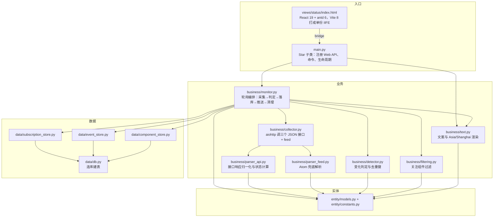

# DeepSeek 服务状态监控与订阅

Feature Name: deepseek-status-monitor
Updated: 2026-10-15

## Description

本设计实现 `specs/deepseek-status-monitor/requirements.md` 中的 11 条需求：轮询 DeepSeek 状态页的公开读接口，主接口不可用时降级到 Atom 订阅源，检测事件与组件状态变化后向订阅会话推送通知，并提供 `dsstatus` 命令、订阅管理、事件历史与全局配置三类 WebUI 能力。

不在范围内：向 DeepSeek 提交任何数据、调用状态页的邮箱订阅接口、抓取状态页以外的页面、90 天可用性百分比展示、对 `api.deepseek.com` 做真实拨测（状态页只反映官方公布的状态）。

## 数据源事实（2026-10-15 实测 + ai-kit 接口文档）

结论：状态页由 Flashduty（快猫）托管，**有公开读 JSON 接口**，不需要解析 HTML。此处所有接口都由本次会话实际 curl 验证过。

| 接口 | 用途 | 实测 | 关键字段 |
|---|---|---|---|
| `GET /api/status-page/6410630422455/summary/active` | **主数据源**：组件目录 + 组件当前状态 + 未结束事件 | 200，`application/json`，2.3 KB | `data.page.components[]`（`component_id`、`name`、`description`、`section_id`、`order_id`）、`data.page.sections[]`、`data.active_changes[]` |
| `GET /api/status-page/6410630422455/change/list?start_at_seconds=&end_at_seconds=` | 事件列表，补已结束事件 | 200（时间参数可省，省略时返回更长历史） | `data.items[]`：`change_id`、`type`、`title`、`description`、`status`、`affected_components[]`、`start_at_seconds`、`close_at_seconds`、`updates[]` |
| `GET /api/status-page/6410630422455/change/info?change_id=` | 单条事件补全（列表缺 `updates` 时） | 200 | `data` 即一条事件，结构同 `items[]` 元素 |
| `GET /feed.atom` | **兜底数据源**：事件级订阅源 | 200，`application/atom+xml` | entry：`title`、`updated`、`id`（`urn:flashduty:change:{change_id}`）、`link`、`summary`（含 `Status:` 与受影响组件名） |
| `GET /api/status-page/6410630422455/summary/structure?start_at_from_seconds=&start_at_to_seconds=` | 90 天可用性与影响区间 | 200；缺参数时 400 `InvalidParameter` | `component_uptimes[]`、`component_impacts[]`、`linked_changes[]`；本轮不实现 |
| `GET /api/v2/summary.json` | Atlassian Statuspage 风格 | 404 `RouteNotFound`，**不存在** | — |

约定与坑：

- 成功体为 `{"request_id": "...", "data": {...}}`；失败体为 `{"request_id": "...", "error": {"code", "message"}}`，HTTP 400 也是这个形状。
- 时间字段一律 Unix 秒（`start_at_seconds`、`at_seconds`、`close_at_seconds`），不是毫秒。
- 组件状态只有四种：`operational` < `degraded` < `partial_outage` < `full_outage`。维护是事件的 `type`（`incident` / `maintenance`），**不进入组件状态枚举**。
- 事件状态：`investigating`、`identified`、`monitoring`、`resolved`、`scheduled`、`ongoing`、`completed`；只有 `resolved` 与 `completed` 算已结束，`monitoring` 不算恢复。
- **已结束事件的 `affected_components[].status` 会回到 `operational`**，不能当故障级别用；当时的影响看 `updates[].component_changes[].status`。
- `update_id` 可能为空字符串，`close_at_seconds`、`daily_uptime`、`notify_subscribers` 不保证有值。
- `summary/active` 响应头带 `s-maxage=10, stale-while-revalidate=30`；页面前端 60 秒刷新一次。因此默认轮询 60 秒、下限 30 秒。
- 组件 ID 与名称以 `summary/active` 的 `page.components` 为准，不写死在代码里。
- 不要调用 `POST /api/status-page/{page_id}/subscription/create`（那是邮箱订阅）。
- `feed.atom` 与 `feed.rss` 只有标题、状态、摘要与受影响组件名，**没有组件 ID**，不适合做组件级状态机。

## Architecture

依赖单向：`main.py` → `business/` → `data/`；`entity/` 不依赖 AstrBot，也不访问数据库，只放数据形状与固定值。`main.py` 不直接执行 SQL，页面接口只做参数校验与转发。

一次轮询的顺序（照接口文档的「最小轮询顺序」）：

1. `GET /summary/active` → 组件目录 + 未结束事件 → 算组件状态与整体状态。
2. `GET /change/list`（窗口 = 上次检查时间 − 600 秒 → 当前时间 + 120 秒）→ 补上刚结束、已不在 `active_changes` 里的事件。
3. 列表项缺 `updates` 时才 `GET /change/info` 补全。
4. 与数据库里的去重状态比对，生成新开 / 状态变化 / 恢复三类通知。
5. 推送 → 写推送结果 → 按保留天数清理。

关键约定：

- 插件数据目录用 `StarTools.get_data_dir(PLUGIN_NAME)` **显式传插件名**。`get_data_dir` 不传名时靠调用栈取 `star_map[module.__name__]`，而 `star_map` 只登记插件主模块路径，从 `data/db.py` 子模块调用会抛 `RuntimeError`（参考 [^3]）。
- 页面目录用官方首选名 `views/`（`pages/` 仅作兼容别名，参考 [^5]、[^6]），本次只做 **一个视图** `views/status/`，页内用 antd `Tabs` 切换「概览与配置 / 订阅管理 / 事件历史」三块，不改顶层 hash。前端源码在 `dashboard/`，技术栈取 ai-kit 默认技术栈的 **React 19 + antd 6 + TypeScript 6 + Vite 8**（参考 [^16]、[^17]）。
- 轮询用 `asyncio` 后台任务，在 `initialize()` 启动、`terminate()` 取消（参考 [^7]、[^8]），不引入 `apscheduler`。
- 页面 ID `6410630422455` 写成常量；状态页重建时改这一处。

## Components and Interfaces

### 实体层 `entity/`

`entity/constants.py`

| 名字 | 含义 |
|---|---|
| `PLUGIN_NAME` | `"astrbot_plugin_deepseek_status"` |
| `STATUS_PAGE_BASE` | `"https://status.deepseek.com"` |
| `PAGE_ID` | `"6410630422455"` |
| `FEED_ATOM_URL` | `"https://status.deepseek.com/feed.atom"` |
| `REQUEST_TIMEOUT_SECONDS` | `10` |
| `COMPONENT_SEVERITY` | `dict[str, int]`：`operational` 0、`degraded` 1、`partial_outage` 2、`full_outage` 3 |
| `CLOSED_EVENT_STATUSES` | `{"resolved", "completed"}` |
| `EVENT_LIST_LOOKBACK_SECONDS` / `EVENT_LIST_LOOKAHEAD_SECONDS` | `600` / `120` |
| `BACKOFF_MAX_MULTIPLIER` | `4` |
| `NOTIFY_*` | 五类通知类型常量：`incident_opened`、`incident_updated`、`incident_resolved`、`component_changed`、`source_failure` |
| `COMMAND_NAME` | `"dsstatus"` |
| `DISPLAY_TIMEZONE` | `ZoneInfo("Asia/Shanghai")` |

`entity/models.py`：`Component`、`StatusChange`、`Snapshot`、`Subscription`、`Notification` 五个 `dataclass`（字段见「Data Models」）。

### 数据层 `data/`

`data/db.py`

- `def get_db_path() -> Path`：返回 `StarTools.get_data_dir(PLUGIN_NAME) / "deepseek_status.db"`；只在插件运行时调用。
- `def connect(db_path: Path) -> sqlite3.Connection`：打开指定路径的连接并设 `row_factory`；路径由调用方传入，测试只传临时目录，因此不必导入 `astrbot`。
- `def init_db(conn: sqlite3.Connection) -> None`：建四张表（`CREATE TABLE IF NOT EXISTS`）。

`data/subscription_store.py`

- `def list_subscriptions(conn, only_enabled: bool = False) -> list[Subscription]`：列出订阅。
- `def get_by_session(conn, session: str) -> Subscription | None`：按会话标识查。
- `def get_by_id(conn, sub_id: int) -> Subscription | None`：按主键查。
- `def subscribe_session(conn, session: str, note: str) -> tuple[Subscription, bool]`：命令订阅；已存在则**保留**原关注组件与启用开关，返回 `(记录, 是否新建)`。
- `def set_components(conn, session: str, component_ids: list[str]) -> bool`：写关注组件清单，记录不存在时返回 `False`。
- `def disable_session(conn, session: str) -> bool`：命令退订置为停用。
- `def create(conn, session: str, note: str, component_ids: list[str], enabled: bool) -> tuple[bool, str]`：页面新增，会话标识重复时返回失败原因。
- `def update(conn, sub_id: int, note: str, component_ids: list[str], enabled: bool) -> bool`：页面编辑。
- `def delete(conn, sub_id: int) -> bool`：页面删除。

`data/event_store.py`

- `def known_event_statuses(conn) -> dict[int, str]`：读出 `change_id -> 最后一次记录的事件状态`，用于判定新开 / 变化 / 恢复。
- `def record_event(conn, change: StatusChange) -> str`：按 `(change_id, status)` 插入，返回 `"opened"` / `"updated"` / `"resolved"` / `"none"`。
- `def record_component_status(conn, component_id: str, status: str) -> bool`：组件状态变化插入，返回是否首次。
- `def record_push(conn, session: str, dedup_key: str, notify_type: str, ok: bool, error: str) -> None`：写入一条推送结果（`UNIQUE(session, dedup_key)`）。
- `def list_events(conn, page: int, size: int) -> tuple[list[dict], int]`：事件分页（按事件时间倒序）。
- `def list_pushes(conn, dedup_key: str) -> list[dict]`：某事件的推送结果，供页面展开查看。
- `def list_pending_retry(conn) -> list[dict]`：`result='failed'` 且 `retry_count < 1` 的记录。
- `def mark_retried(conn, push_id: int) -> None`：重试次数加一。
- `def purge_expired(conn, retention_days: int) -> int`：删除超过保留天数的事件与推送结果，返回删除条数。

`data/component_store.py`

- `def load_statuses(conn) -> dict[str, str]`：读取上一次的组件状态。
- `def save_status(conn, component_id: str, status: str) -> None`：写入组件当前状态。
- `def prune_missing(conn, component_ids: list[str]) -> None`：删掉状态页已下架的组件。

### 业务层 `business/`

`business/collector.py`

- `class CollectorError(Exception)`：请求层失败的统一异常（超时、非 200、响应不是合法 JSON），与解析层的结构错误分开。
- `async def fetch_summary_active() -> dict`：GET `summary/active`，返回响应体的 `data` 字段；非 200 或 JSON 解析失败抛 `CollectorError`。
- `async def fetch_change_list(start_seconds: int, end_seconds: int) -> list[dict]`：GET `change/list`，返回 `data.items`。
- `async def fetch_change_info(change_id: int) -> dict`：GET `change/info`，返回 `data`。
- `async def fetch_feed_atom() -> str`：GET `feed.atom`，返回正文文本。
- `def make_timeout() -> aiohttp.ClientTimeout`：统一 10 秒超时。
- `def api_url(path: str) -> str`：拼 `STATUS_PAGE_BASE + /api/status-page/{PAGE_ID} + path`。
- 四个 `fetch_*` 的请求失败统一抛 `CollectorError`；解析函数的结构不符统一抛 `ValueError`，`_collect` 据此分开记日志。

`business/parser_api.py`

- `def parse_summary_active(data: dict) -> tuple[list[Component], list[StatusChange]]`：从 `page.components` 与 `active_changes` 解析出组件与未结束事件；结构不符时抛 `ValueError`，错误信息带上缺失或非法的字段名（触发降级并记「接口结构异常」日志）。
- `def parse_component_statuses(components: list[Component], active_changes: list[StatusChange]) -> list[Component]`：按需求 2.2 的算法算出每个组件的当前状态。
- `def parse_change(item: dict) -> StatusChange`：把一条事件归一化为 `StatusChange`（含 `type`、`status`、受影响组件 ID、开始/结束时间、`latest_update_key`、链接）。
- `def latest_update_key(item: dict) -> str`：取最后一条 `updates` 的 `update_id`；为空时用 `at_seconds` 与状态拼接；没有 `updates` 时返回空串。
- `def derive_overall_status(components: list[Component]) -> str`：取 `COMPONENT_SEVERITY` 最高者，组件为空时返回 `operational`。
- `def event_link(change_id: int) -> str`：`https://status.deepseek.com/incidents/{change_id}`。

`business/parser_feed.py`

- `def parse(body: str) -> list[StatusChange]`：解析 Atom entry，取标题、`updated`、`id` 里的 `change_id`、`link`、`summary` 里的 `Status:` 与 `Affected components:`；组件 ID 留空，只保留名称。
- `def parse_affected_names(summary_html: str) -> list[str]`：取出受影响组件名称。

`business/detector.py`

- `def event_dedup_key(change: StatusChange) -> str`：`f"event:{change_id}:{status}"`。
- `def component_dedup_key(component_id: str, status: str) -> str`：`f"component:{component_id}:{status}"`。
- `def source_failure_key(streak_started_at: str) -> str`：`f"source_failure:{streak_started_at}"`，同一段连续失败只提醒一次。
- `def backoff_seconds(interval: int, failures: int) -> int`：`min(interval * 2 ** failures, interval * BACKOFF_MAX_MULTIPLIER)`。
- `def diff_components(old: dict[str, str], new: list[Component]) -> list[tuple[str, str, str]]`：返回 `(组件名, 旧状态, 新状态)` 列表。

`business/filtering.py`

- `def matched_component_ids(keywords: str, components: list[Component]) -> list[str]`：逗号分隔关键字、英文大小写不敏感的名称包含匹配。
- `def subscription_accepts(sub: Subscription, component_ids: list[str]) -> bool`：关注清单为空表示接受全部，否则取交集是否非空。
- `def pick_recipients(subs: list[Subscription], component_ids: list[str], is_global: bool) -> list[Subscription]`：整体状态与数据源失败类通知按 `is_global=True` 发给全部启用订阅。
- `def names_to_component_ids(names: list[str], components: list[Component]) -> list[str]`：兜底源只有名称时，用名称包含匹配回填组件 ID。

`business/text.py`

- `def to_local(epoch_seconds: int) -> str`：Unix 秒转 `Asia/Shanghai` 文本。
- `def render_event(change: StatusChange, notify_type: str) -> str`：事件类通知文案（标题、状态、时间、链接；按 `type` 区分故障与维护）。
- `def render_component(name: str, old: str, new: str) -> str`：组件状态变化文案。
- `def render_source_failure(streak: int) -> str`：数据源连续失败文案。
- `def render_summary(snapshot: Snapshot) -> str`：当前状态摘要（订阅建立或启用时推送）。
- `def render_status_reply(snapshot: Snapshot) -> str`：`dsstatus` 查询回复。
- `def render_help() -> str`：命令用法说明。

`business/monitor.py`

- `class Monitor`：持有 `conn`、`config`、`context`、内存快照、连续失败计数与失败起始时间。
- `async def start(self) -> None` / `async def stop(self) -> None`：起停后台任务。
- `async def run(self) -> None`：循环调用 `_tick`，单轮异常只记日志，失败后按 `backoff_seconds` 延长等待。
- `async def _tick(self) -> None`：采集 → 解析 → 落库 → 生成并推送通知 → 重试上次失败 → 清理过期数据。
- `async def _collect(self) -> Snapshot | None`：主接口成功则用主源；`CollectorError`（请求失败）与 `ValueError`（接口结构异常）都降级到 feed，但记不同的日志；两路都失败返回 `None` 并累加失败计数。
- `async def _dispatch(self, notifications: list[Notification]) -> None`：按过滤结果逐会话推送，单个失败不中断其余会话。
- `async def retry_failed(self) -> None`：重试 `result='failed'` 且未重试过的记录，每轮最多一次。
- `async def push_summary(self, session: str) -> bool`：订阅建立或启用后立即推当前状态摘要。
- `def snapshot(self) -> Snapshot | None`：供命令与页面读取当前快照。
- `def baseline_only(self, snapshot: Snapshot) -> None`：插件启动后的首次采集只写库、不发通知（需求 8.7）。

### 入口层 `main.py`

- `class Plugin(Star)`：`__init__(context, config)` 打开数据库、注册下方全部 Web API、注册命令、创建 `Monitor`；`initialize()` 启动 `Monitor`；`terminate()` 停止 `Monitor` 并关连接。
- `async def dsstatus(self, event, sub: str = "", kw: str = "")`：会话内命令。`sub` 取「订阅 / 退订 / 帮助」，`kw` 为逗号分隔的组件关键字（AstrBot 按空白切分参数并丢弃多余 token，因此多组件必须用逗号，参考 [^9]）。
- Web API 路由（`context.register_web_api`，参考 [^4]）：

| 方法 | 路由 | 处理函数 | 说明 |
|---|---|---|---|
| GET | `/{PLUGIN}/settings` | `page_get_settings` | 读非密钥配置 |
| PUT | `/{PLUGIN}/settings` | `page_save_settings` | 写回配置并 `save_config()` |
| GET | `/{PLUGIN}/status` | `page_get_status` | 当前快照 + 组件状态 |
| GET | `/{PLUGIN}/subscriptions` | `page_list_subscriptions` | 订阅列表 |
| POST | `/{PLUGIN}/subscriptions` | `page_create_subscription` | 新增订阅 |
| PUT | `/{PLUGIN}/subscriptions/<sub_id>` | `page_update_subscription` | 编辑订阅 |
| DELETE | `/{PLUGIN}/subscriptions/<sub_id>` | `page_delete_subscription` | 删除订阅 |
| GET | `/{PLUGIN}/events` | `page_list_events` | 事件分页 |

前端 bridge 用相对 endpoint（`settings`、`subscriptions`、`events`、`status`），请求与响应用 `astrbot.api.web` 的 `request` / `json_response` / `error_response`（参考 [^10]）。

### 前端 `dashboard/` 与 `views/status/`

技术栈按 ai-kit 默认技术栈（2026-10 核对）：**React 19 + antd 6 + TypeScript 6 + Vite 8**（`@vitejs/plugin-react` 6），构建用 Node 24；不引 Tailwind，页面是表单与表格，antd 的四层样式表达足够（参考 [^16]、[^19]）。目录与构建配置照抄现仓 `astrbot_plugin_fzxy` 的 `dashboard/`（参考 [^17]）。

| 文件 | 作用 |
|---|---|
| `dashboard/index.html` | 挂载点 `#root`；内联脚本先按宿主 query 的 `theme` / `isDark` 铺底色，避免首屏闪白 |
| `dashboard/package.json` | `antd ^6.6.5`、`react ^19.3.0`、`@ant-design/cssinjs ^2.1.2`；`build` 脚本为 `tsc --noEmit && vite build` |
| `dashboard/vite.config.ts` | `base: "./"`、`outDir: "../views/status"`、`cssCodeSplit: false`、`format: "iife"`、`entryFileNames: "assets/index.js"`；外加一个 `transformIndexHtml` 插件把 `type="module"` 改写成 `defer` 并去掉 `crossorigin` |
| `dashboard/src/main.tsx` | `StyleProvider layer` 包住应用，让 antd 样式整体进 `@layer antd` |
| `dashboard/src/App.tsx` | `ConfigProvider`（`algorithm` 跟随宿主明暗）+ antd `Tabs` 承载三个视图，`onChange` 只改 React state |
| `dashboard/src/bridge.ts` | 封装 `window.AstrBotPluginView || window.AstrBotPluginPage`，`apiGet` / `apiPost` 先 `await bridge.ready()`，`readError` 取出后端 `error_response` 的中文原因 |
| `dashboard/src/{status,subscriptions,events}-view.tsx` | 概览与配置、订阅管理、事件历史三块视图，各自取数与提交 |
| `dashboard/src/style.css` | 无 `@layer` 的自定义 CSS，按规范天然压过 antd 样式，不写 `!important` |

构建命令 `cd dashboard && npm run build`，产物提交进仓库（`views/status/index.html`、`views/status/assets/index.js`、`views/status/assets/style.css`），运行时不需要 Node（参考 [^18]）。

## Data Models

### `_conf_schema.json`（非密钥，全部出现在配置页）

| 字段 | 类型 | 默认 | 约束 |
|---|---|---|---|
| `enabled` | bool | `false` | 监控总开关 |
| `poll_interval_seconds` | int | `60` | 30 至 3600 |
| `notify_enabled` | bool | `true` | 通知推送开关 |
| `event_retention_days` | int | `30` | 1 至 365 |
| `failure_threshold` | int | `3` | 1 至 10 |

本插件没有密钥类配置项，因此配置页展示全部字段，配置接口不需要屏蔽任何键。

### 内存结构

- `Component`：`component_id`、`name`、`section_id`、`status`。
- `StatusChange`：`change_id`、`change_type`、`title`、`description`、`status`、`component_ids`、`component_names`、`start_at_seconds`、`close_at_seconds`、`latest_update_key`、`link`。
- `Snapshot`：`overall_status`、`components: list[Component]`、`changes: list[StatusChange]`、`source`（`api` / `feed`）、`fetched_at`（UTC ISO8601 带 `Z`）。
- 失败计数与失败起始时间：插件进程内维护，重启后重新计数；重启后的首次采集只建基线不发通知。

### SQLite（`data/plugin_data/astrbot_plugin_deepseek_status/deepseek_status.db`）

`subscriptions`

| 列 | 类型 | 说明 |
|---|---|---|
| `id` | INTEGER PRIMARY KEY AUTOINCREMENT | 主键 |
| `session` | TEXT NOT NULL UNIQUE | `unified_msg_origin` |
| `note` | TEXT NOT NULL DEFAULT '' | 备注名 |
| `component_ids` | TEXT NOT NULL DEFAULT '[]' | 关注组件 ID 的 JSON 数组，空数组=关注全部 |
| `enabled` | INTEGER NOT NULL DEFAULT 1 | 启用开关 |
| `created_at` / `updated_at` | TEXT NOT NULL | UTC ISO8601 带 `Z` |

`events`

| 列 | 类型 | 说明 |
|---|---|---|
| `id` | INTEGER PRIMARY KEY AUTOINCREMENT | 主键 |
| `change_id` | INTEGER NOT NULL | 事件 ID |
| `status` | TEXT NOT NULL | 事件状态取值 |
| `change_type` | TEXT NOT NULL | `incident` / `maintenance` |
| `title` / `description` | TEXT NOT NULL DEFAULT '' | 标题与描述 |
| `component_ids` | TEXT NOT NULL DEFAULT '[]' | 受影响组件 ID |
| `component_names` | TEXT NOT NULL DEFAULT '[]' | 受影响组件名（兜底源只有名称） |
| `start_at` / `close_at` | TEXT | 开始与结束时间，UTC ISO8601 带 `Z`；未结束时 `close_at` 为 NULL |
| `latest_update_key` | TEXT NOT NULL DEFAULT '' | 最近进展标识 |
| `link` | TEXT NOT NULL DEFAULT '' | 事件详情链接 |
| `first_seen_at` | TEXT NOT NULL | 首次采集时间 |
| 唯一约束 | `UNIQUE(change_id, status)` | 事件通知去重键 |

`push_records`

| 列 | 类型 | 说明 |
|---|---|---|
| `id` | INTEGER PRIMARY KEY AUTOINCREMENT | 主键 |
| `session` | TEXT NOT NULL | 会话标识 |
| `dedup_key` | TEXT NOT NULL | 通知去重键 |
| `notify_type` | TEXT NOT NULL | 五类通知类型之一 |
| `result` | TEXT NOT NULL | `ok` / `failed` |
| `error` | TEXT NOT NULL DEFAULT '' | 失败原因 |
| `retry_count` | INTEGER NOT NULL DEFAULT 0 | 已重试次数 |
| `created_at` / `updated_at` | TEXT NOT NULL | UTC ISO8601 带 `Z` |
| 唯一约束 | `UNIQUE(session, dedup_key)` | 同会话同通知只留一条 |

`component_states`

| 列 | 类型 | 说明 |
|---|---|---|
| `component_id` | TEXT PRIMARY KEY | 组件 ID |
| `status` | TEXT NOT NULL | 上次采到的组件状态 |
| `updated_at` | TEXT NOT NULL | 更新时间 |

## Correctness Properties

- **P1 幂等**：同一 `(change_id, status)` 事件与同一 `(component_id, status)` 组件状态各只生成一次通知，重复轮询不产生重复推送。
- **P2 不丢推送**：落库成功的通知若推送失败，记录为 `failed` 且 `retry_count < 1`，下一轮必被重试一次；重试后无论成败都不再重试。
- **P3 时间一致**：数据库全部时间列为 UTC ISO8601 带 `Z`，来源的 Unix 秒在此处换算；推送与命令回复固定按 `Asia/Shanghai` 渲染，页面按访问者浏览器本地时区渲染（参考 [^11]）。
- **P4 快照一致**：内存快照只在采集成功且数据库写入成功之后替换；本轮落库失败则整条通知不发送。
- **P5 空清单语义**：订阅的 `component_ids` 为空数组表示关注全部组件；它不表示停用，停用只由 `enabled` 表达。
- **P6 状态级联**：组件的当前状态 = 该组件在全部「未结束事件」中的最严重影响，默认 `operational`；整体状态 = 全部组件中最严重者。
- **P7 降级不误报**：兜底源采集不产生组件状态变化通知，也不改变组件状态表（需求 2.10）。
- **P8 过滤正确**：事件通知只发给受影响组件与关注清单有交集的订阅；整体状态与数据源失败通知发给全部启用订阅。
- **P9 已结束事件不参与当前状态**：`resolved` 与 `completed` 事件被跳过；已结束事件的 `affected_components[].status` 不参与状态计算。
- **P10 基线不刷屏**：进程启动后的首次采集只写库与建去重基线，历史事件一条都不推。

## Error Handling

| 场景 | 处理 |
|---|---|
| 主接口超时、非 200、响应不是合法 JSON | 本轮改用兜底源，记 `warning` 日志「主接口请求失败」并附原因，快照 `source` 置 `feed` |
| 主接口返回 200 但响应结构不符合预期（缺字段、类型不符） | 本轮改用兜底源，记 `warning` 日志「接口结构异常」并附缺失或非法的字段名；不计入失败次数。结构异常持续期间组件级通知始终不可用，只能从这条日志发现 |
| 主接口返回 400 `InvalidParameter` | 把 `error.code` 与 `error.message` 写日志，按采集失败处理 |
| 兜底源 304 或内容未变 | 视为无变化，复用上一份快照，不计失败 |
| 兜底源成功但无组件级数据 | 只更新事件集合，组件状态与组件表保持不动，日志标注没有组件级状态 |
| 主源与兜底源都失败 | 保留上一份快照，失败计数加一，下一次轮询按 `backoff_seconds` 延长等待 |
| 连续失败计数达到阈值 | 生成一条 `source_failure` 通知（键含失败起始时间，同一段失败只提醒一次） |
| 采集成功 | 失败计数归零 |
| 数据库写入失败 | 记 `error` 日志，本轮不推送该通知，内存快照不替换 |
| 单会话推送失败 | 记 `failed` 与原因，继续处理其余会话，下一轮重试一次 |
| 会话标识失效（`send_message` 返回 `False`） | 记 `failed`，页面推送结果中可见，不自动停用该订阅 |
| `change/info` 补全失败 | 该事件按列表里已有字段入库，日志记 warning，不影响其余事件 |
| 命令参数不识别、快照为空 | 回复帮助文案或「暂无状态数据」，不抛异常 |
| 页面接口收到非对象请求体或非法 `sub_id` | 返回 400 与中文错误信息 |
| 页面接口写入配置类型不符 | 返回 400，不改动配置 |
| 状态页组件下架 | 组件状态表清理该组件，不影响其余组件与事件 |

## Test Strategy

单元测试全部走 `python3.12 -m unittest`（AstrBot 要求 Python ≥ 3.12，本机 `python3` 是 3.9.6），不连网络、不连真实 AstrBot，也不导入 `astrbot` 包。

| 测试文件 | 覆盖内容 |
|---|---|
| `tests/test_parser_api.py` | 用落盘的接口响应 fixture 验证组件解析、未结束事件解析、`latest_update_key`（含 `update_id` 为空、缺 `updates` 两种退化）、组件状态计算、整体状态级联、结构被破坏时抛 `ValueError` 且信息含字段名 |
| `tests/test_parser_feed.py` | 用落盘的 `feed.atom` fixture 验证 `change_id`、标题、时间、链接、`Status:` 与受影响组件名解析 |
| `tests/test_detector.py` | 事件去重键、`opened`/`updated`/`resolved`/`none` 判定、组件差异比较、退避秒数上限 |
| `tests/test_filtering.py` | 关键字模糊匹配（逗号分隔、大小写不敏感、无匹配）、空清单=全部、交集判定、名称回填组件 ID |
| `tests/test_stores.py` | 临时目录 SQLite：订阅增删改与命令订阅保留原关注组件、`UNIQUE(change_id, status)` 约束、推送结果与待重试查询、过期清理 |
| `tests/test_text.py` | Unix 秒转 `Asia/Shanghai`、五类文案渲染含链接与时间、维护与故障文案区分 |
| `tests/test_monitor.py` | 用假采集函数替换网络层：正常一轮、主接口失败降级、两路失败累计与阈值提醒、退避生效、推送失败重试一次、兜底不发组件通知、首次采集只建基线、主接口返回 200 但结构缺失时降级并记「接口结构异常」日志 |

fixture 与集成验证：

- `tests/fixtures/summary_active.json`、`tests/fixtures/change_list.json`、`tests/fixtures/feed_atom.xml` 各存一份实测样本（提交进仓库）。
- 真实网络验证写成一个默认 `skip` 的用例，设 `DEEPSEEK_STATUS_LIVE=1` 时才执行，避免 CI 依赖外网。
- `active_changes` 目前实测为空数组：实现时若抓到一份含进行中事件的真实响应，把样本补进 fixture，并据此补一条「事件进行中时组件状态正确」的用例。

页面验收：

- 构建前 `cd dashboard && npm run build` 必须通过 `tsc --noEmit` 类型检查，无报错；沿用仓库既有配置，不新增第二套风格。
- `views/status/index.html` 只引用 `./assets/index.js`（`script defer`）与 `./assets/style.css`，产物为单份 IIFE，无 `type="module"`、无 `crossorigin`、无 CDN/importmap、不出现第二份 JS chunk。
- `views/status/assets/index.js` 内不出现不带空格的 `from"./x.js"` 形式外部相对导入（AstrBot 只改写带空格的 `from "./x.js"`）。
- 手工检查：三个 Tab 可切换且不改顶层 hash；配置页加载时显示 schema 当前值，保存后 `save_config()` 生效；订阅页启用开关由停用改启用会立刻收到一条状态摘要；深色模式下底色与文本正常（`body.is-dark` + `theme.darkAlgorithm`）。

## 决策与待确认事项

1. **新增进展不单独推送**：ai-kit 接口文档建议 `incident_updated` 在「出现新 `update_id`」时触发，本设计的触发条件比它窄——只有事件状态取值变化才推送，新增进展只入库供页面查看（需求 3.7）。理由是用户选择「只在状态变化时推送」，避免一次事件刷屏；`latest_update_key` 已落库，将来要放宽只需改 `detector.py` 一处判定。
2. **不使用 `/summary/structure`**：90 天可用性与影响区间是展示型数据，本轮不做；`tests/fixtures` 也不存它的样本。
3. **页面 ID 写死**：`6410630422455` 作为常量。状态页重建时改这一处；文档提到可从首页 HTML 读 `initialPageConfig.page_id`，本设计不为此引入 HTML 解析。
4. **`active_changes` 含进行中事件时未实测**：实测时该数组为空数组，组件状态算法按接口文档第 4 节实现（跳过 `resolved` / `completed`，取受影响组件最严重状态）。实现时若抓到真实响应，按上面 fixture 约定补样本与用例。
5. **接口没有正式承诺**：字段可能变。所有解析都做防御式处理，结构不符即抛异常走兜底源，不猜字段。
6. **本机 Python 默认版本低于 AstrBot 要求**：AstrBot `requires-python = ">=3.12"`，本机 `python3` 是 3.9.6，`python3.12` 是 3.12.14。测试与本地调试统一用 `python3.12 -m unittest`；数据层 `connect(db_path)` 接收显式路径，测试传临时目录。
7. **本机构建链满足前端要求**：Node v24.21.0、npm 11.19.0，满足 Vite 8 与 Node 24 的要求。
8. **命令第三个 token 会被丢弃**：AstrBot 的命令参数按空白切分并按位置映射，多余部分丢弃 [^9]。因此多组件用逗号分隔，帮助文案中写明。
9. **`page.components` 是组件唯一权威**：不把组件 ID 写进代码或 `_conf_schema.json`，组件过滤靠 ID，名称只用于人读与兜底回填。

## References

[^1]: (Website) - [DeepSeek 官方状态页](https://status.deepseek.com/)
[^2]: (docs/deepseek-status-api.md) - [ai-kit：DeepSeek 状态页监控 API 接口文档（本次设计的主要接口依据）](https://github.com/w1ndys/ai-kit/blob/main/docs/deepseek-status-api.md)
[^3]: (astrbot/core/star/star_tools.py#L244) - [StarTools.get_data_dir 的插件名解析](https://github.com/AstrBotDevs/AstrBot/blob/master/astrbot/core/star/star_tools.py#L244)
[^4]: (astrbot/core/star/context.py#L741) - [Context.register_web_api 注册插件 API](https://github.com/AstrBotDevs/AstrBot/blob/master/astrbot/core/star/context.py#L741)
[^5]: (astrbot/dashboard/services/plugin_page_service.py#L27) - [插件视图目录 views 优先、pages 兼容](https://github.com/AstrBotDevs/AstrBot/blob/master/astrbot/dashboard/services/plugin_page_service.py#L27)
[^6]: (docs/zh/dev/star/guides/plugin-pages.md#L10) - [插件可视化视图放在 views/ 下](https://github.com/AstrBotDevs/AstrBot/blob/master/docs/zh/dev/star/guides/plugin-pages.md#L10)
[^7]: (astrbot/core/star/star_manager.py#L1424) - [插件加载时调用 initialize()](https://github.com/AstrBotDevs/AstrBot/blob/master/astrbot/core/star/star_manager.py#L1424)
[^8]: (astrbot/core/star/star_manager.py#L1966) - [插件卸载时调用 terminate()](https://github.com/AstrBotDevs/AstrBot/blob/master/astrbot/core/star/star_manager.py#L1966)
[^9]: (astrbot/core/star/filter/command.py#L192) - [命令参数按空白切分并按位置映射](https://github.com/AstrBotDevs/AstrBot/blob/master/astrbot/core/star/filter/command.py#L192)
[^10]: (astrbot/api/web.py#L443) - [插件 Web API 可用的 request / json_response / error_response](https://github.com/AstrBotDevs/AstrBot/blob/master/astrbot/api/web.py#L443)
[^11]: (docs/dev-conventions.md#L49) - [ai-kit：时间存 UTC，展示层换算](https://github.com/w1ndys/ai-kit/blob/main/docs/dev-conventions.md)
[^12]: (docs/zh/dev/star/guides/plugin-config.md#L9) - [插件配置 schema 字段类型与 secret](https://github.com/AstrBotDevs/AstrBot/blob/master/docs/zh/dev/star/guides/plugin-config.md#L9)
[^13]: (docs/zh/dev/star/guides/storage.md#L21) - [大文件与业务数据放 data/plugin_data/{plugin_name}/](https://github.com/AstrBotDevs/AstrBot/blob/master/docs/zh/dev/star/guides/storage.md#L21)
[^14]: (docs/zh/dev/star/guides/send-message.md#L19) - [主动消息与 unified_msg_origin](https://github.com/AstrBotDevs/AstrBot/blob/master/docs/zh/dev/star/guides/send-message.md#L19)
[^15]: (specs/deepseek-status-monitor/requirements.md) - [本功能需求文档](requirements.md)
[^16]: (docs/dev-conventions.md#L28) - [ai-kit：前端默认栈 React 19 + antd 6、Vite 8 + TS 6、Node 24](https://github.com/w1ndys/ai-kit/blob/main/docs/dev-conventions.md)
[^17]: (astrbot_plugin_fzxy/dashboard/vite.config.ts) - [同类插件 Pages 构建配置参考实现](https://github.com/w1ndys/astrbot_plugin_fzxy)
[^18]: (docs/astrbot-plugin-pages-cdn.md#L14) - [ai-kit：Pages 打成一份 IIFE 的构建要求与踩坑](https://github.com/w1ndys/ai-kit/blob/main/docs/astrbot-plugin-pages-cdn.md)
[^19]: (docs/react-antd-tailwind-guidelines.md#L15) - [ai-kit：StyleProvider layer 与样式分层顺序](https://github.com/w1ndys/ai-kit/blob/main/docs/react-antd-tailwind-guidelines.md)
